# dsh-custom-plugin

[](https://www.npmjs.com/package/@alexpeng/dsh-custom-plugin)
[](LICENSE)
[](#install)
[](https://www.typescriptlang.org)
[](https://github.com/AlexPeng07/dsh-custom-plugin/actions/workflows/ci.yml)
[](https://awesome-dsh-plugin.com)

<p align="center">
  
</p>

English | [中文](README.zh.md)

Custom convenience suite for the DeepSeek Harness (DSH) Web GUI: personalization, weather FX, background motion, glass effects, project folders, enhanced prompts, conversation export/search, Mermaid rendering, 7/30/90-day usage analytics, budget and key-free local backups, plus a Ctrl/Cmd+K command palette.

The plugin is dual-face: the host half (`src/`) owns the state document, registers the `/api/custom-plugin` routes and the `custom_plugin_status` agent tool; the browser half (`src/client/`) injects its UI through eight injections into seven official slots and talks to the host over same-origin fetch. Mounted through the official profile mechanism — no DSH source changes.

<p align="center">
  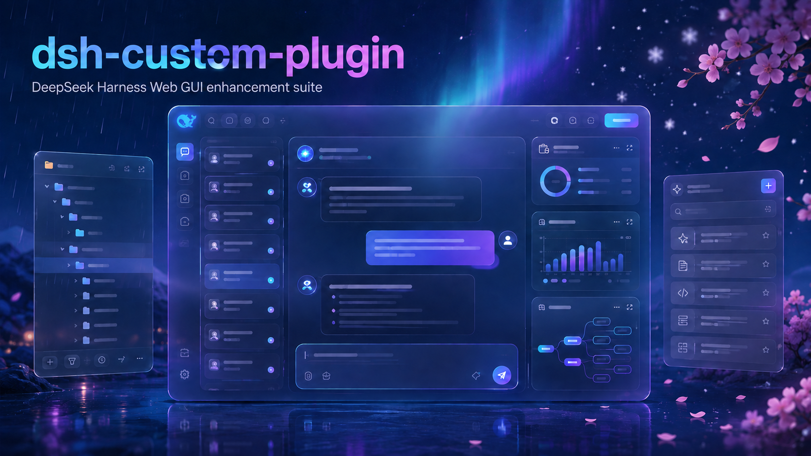
</p>

## Selected screenshots

<table>
<tr>
<td width="50%" valign="top"><b>Settings → 个性化: the full-page appearance config</b><br>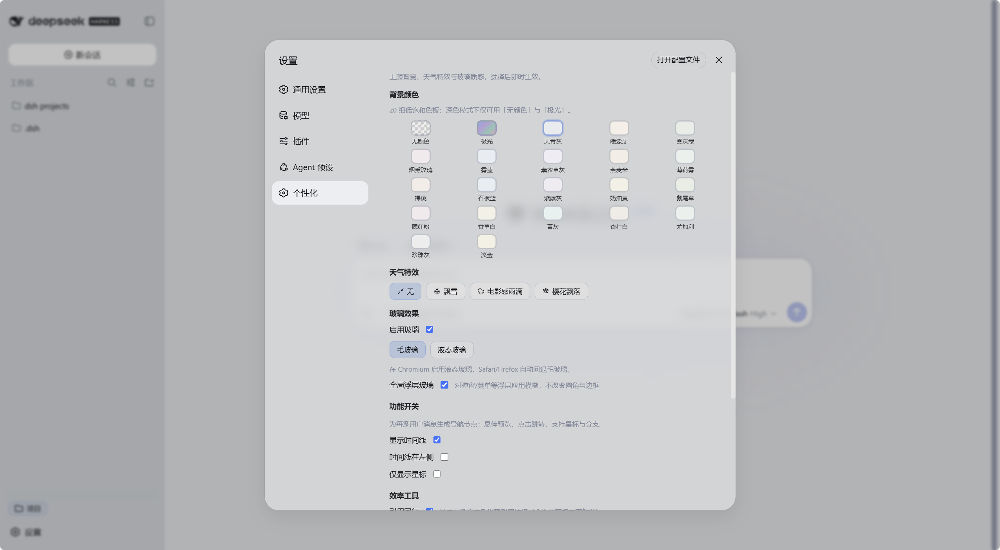</td>
<td width="50%" valign="top"><b>The same panel as a popover from the session header (light theme)</b><br>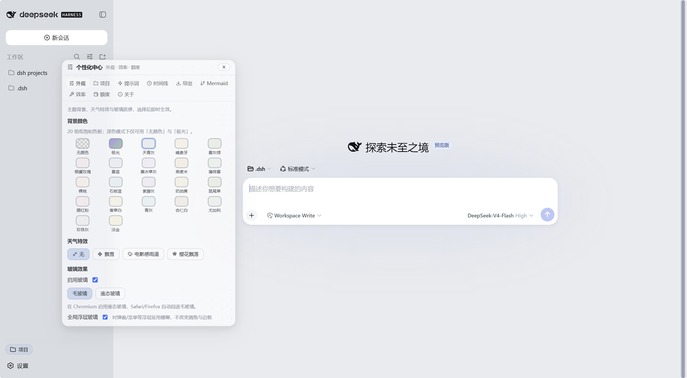</td>
</tr>
<tr>
<td width="50%" valign="top"><b>Liquid glass (displacement refraction on Custom surfaces)</b><br>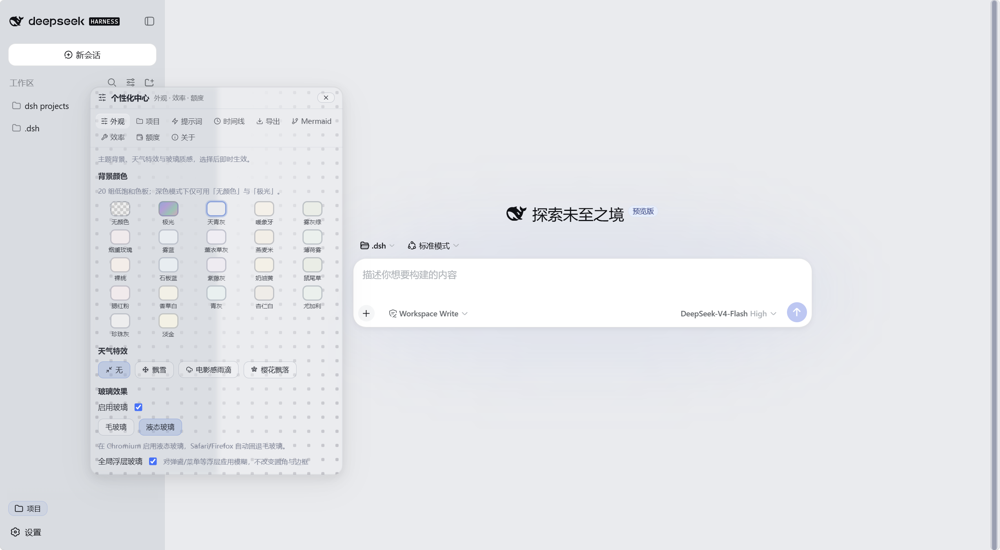</td>
<td width="50%" valign="top"><b>Multi-level project folders</b><br>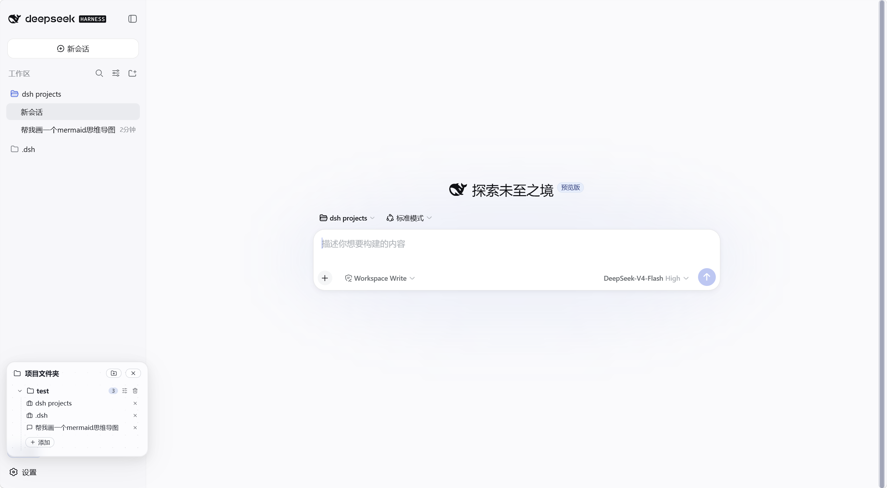</td>
</tr>
<tr>
<td width="50%" valign="top"><b>Mermaid mindmap rendered in place</b><br>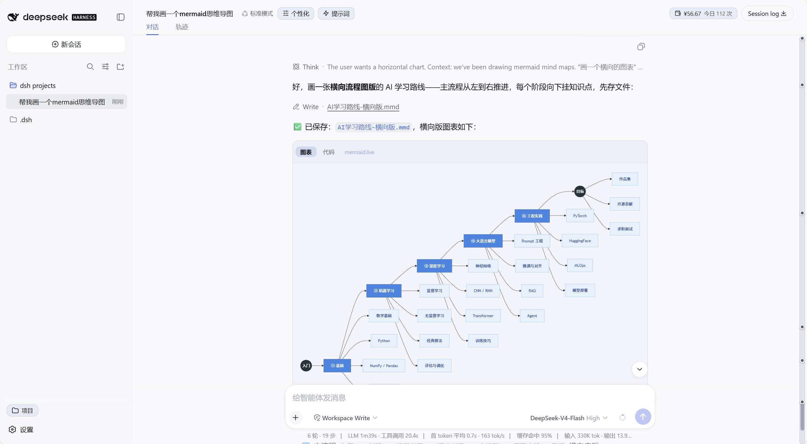</td>
<td width="50%" valign="top" align="center"><b>Balance and today's per-model usage</b><br>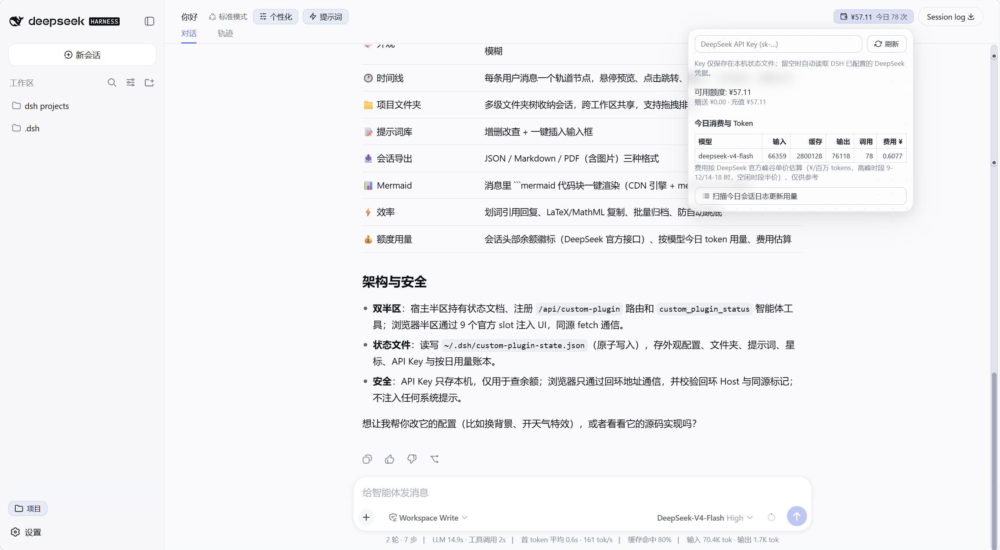</td>
</tr>
<tr>
<td width="50%" valign="top" align="center"><b>Rain (three depth layers)</b><br>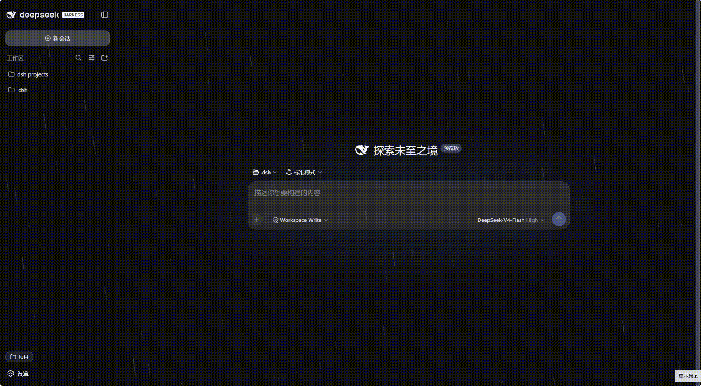</td>
<td width="50%" valign="top" align="center"><b>Sakura</b><br>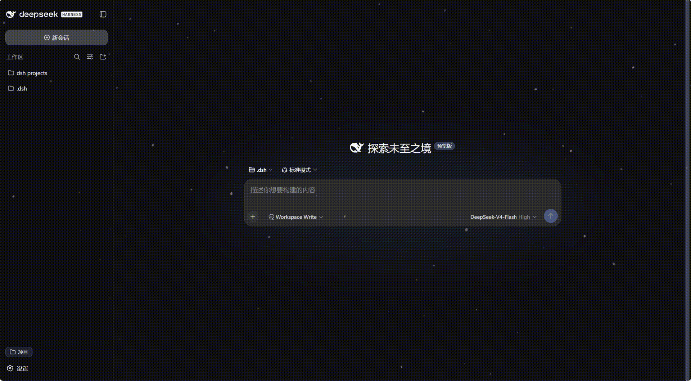</td>
</tr>
<tr>
<td width="50%" valign="top" align="center"><b>Snow</b><br>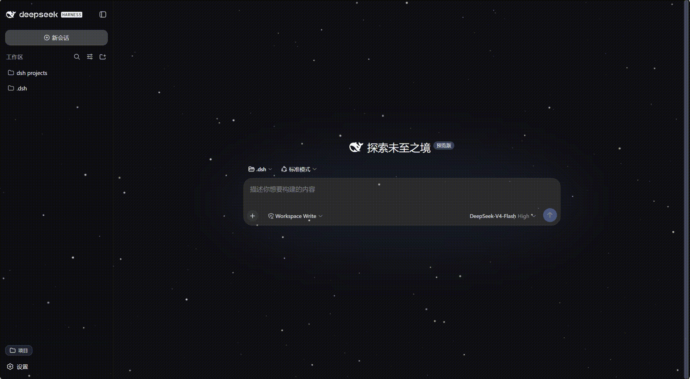</td>
</tr>
</table>

Weather FX is shown in dark mode. Usage history, backup-import previews, session search, and the command palette are dynamic views of the same panel; open them inside DSH to inspect the live UI — no additional fixed screenshots are included.

## What it does

### Appearance

- **Background colors**: 20 muted low-saturation palettes (each with a matching tab color, `天青灰` by default) plus "no color" (follows the GUI default theme). Every palette works in both themes; dark mode derives the same family's dark variant (hue and low saturation kept, lightness dropped onto the dark ramp), and the swatch preview shows what the current theme will actually paint.
- **Weather FX**: canvas-rendered, pointer-transparent one-click overlays — falling snow, cinematic rain (three depth layers with splashes), and drifting sakura petals; turning it off clears the canvas.
- **Glass**: frosted glass on every Custom surface, or liquid glass (a rounded-rect SDF displacement map refracts all four edges, with a restrained blur + saturation, a 1px specular rim and the host fill at ~70% so text over large panels stays readable; engines without SVG-referencing backdrop filters fall back to frosted). When a background renderer is live, the glass switches to a centre-solid / edge-clear radial fill and a contrast-boosted backdrop so the animation stays visible at the rim without hurting the copy. A global-glass option extends the same treatment to dialogs, menus, tooltips, listboxes and the system settings window — displaced as well in liquid mode.
- **Native surfaces**: the header's 个性化 button opens only a compact appearance popover anchored to it — flipped upward when the viewport runs short, never a draggable window — while folders, prompts, search, export, Mermaid, efficiency, usage and data management all live in the 个性化 section of DSH Settings. Popovers, menus and settings cards use the host's menu material, elevation shadows, radius scale and type scale, with 150–220 ms open/close motion that starts from the anchor's edge (toasts also animate out in place) and respects the system's reduced-motion preference.
- **Background motion**: a full-page animated layer beneath the content, in two independent tiers — ASCII glyph grids (`flow`, `rain`, `ocean`, `starfield`, `ripple`, plus the zero-animation `static`) and 光影 (the shader tier: one full-screen WebGL1 shader per style, `liquid`, `grain`; a page without WebGL falls back to the ASCII tier and says so). The panel switches tier and preset, tunes density, speed, frame rate, font size and opacity — intensity instead of font/opacity on the shader tier — and "restore defaults" resets only those six parameter overrides back to "follow the current preset"; the tier and preset themselves are never changed by that button, and the panel says so next to it. Every slider clamps to the active preset's declared range. Ink strength is a separate three-step choice (柔和 / 标准 / 强烈) that scales the ink step without touching density, speed or frame rate, and the **avoid-the-copy** switch (避让正文, on by default) fades the texture behind the reading column while the page edges keep full strength — turning it off makes the whole page uniform. While the effect is on, the shell's page fills become translucent so the texture shows; with glass on, cards and popovers become glass over that texture — the centre keeps enough tint for the copy while the edges reveal the animation — and dialogs stay opaque. `ocean`, `flow`, `rain`, `ripple` and `starfield` respond to the pointer. The `ocean` preset lives inside the conversation column, so the water is visible behind the messages; drag to leave ripples, click for a splash, and the fish school scatters and regroups. `flow` stays a page-level background, but the pointer now stirs its fog: dragging bends and thickens the noise along the path, and a click pushes a ring through it. `rain` reads the pointer as wind: a flick slants the falling trails and a click parts the curtain to both sides, then it slowly closes again. In `ripple`, a click drops a new ring where it lands and a drag leaves a trail of small ones. `starfield` keeps its sparse character — a press lights a small burst of stars and a drag scatters a thin trail, both fading out in about a second. The shader tier's `liquid` also follows the pointer: moving it twists the ink cloud and a click sends a ring outward, while `grain` stays a static speck field by design. The other presets are still page-level backgrounds.

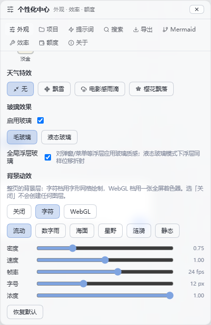

### Project folders

A multi-level folder tree persisted in the `$DSH_HOME` state file, shared across workspaces. Any workspace or session can be folded in; folders support drag-to-reorder (before / inside / after) plus move-up/down buttons, inline rename (double-click or the pencil), delete confirmation, search over names and references, and add-current-session shortcuts. Empty and no-match states both say what to do next.

### Prompts

Add and edit in a single form dialog (name, body, tags, favorite; `Ctrl/⌘+Enter` saves) instead of three chained prompts. The list supports search, tag and favorite filters, and manual / recent / use-count / name sorting, with recency and use counts recorded. Deletes can be undone from the toast for five seconds; imports preview valid, skipped and conflicting records before merging or replacing. A dirty editor asks "discard changes / keep editing" before Escape, mask click or Cancel closes it. `{{variable}}` placeholders open a fill-in form before insertion. The library supports versioned JSON and heading-based Markdown import/export.

### Conversation export

Pick a format card to export the current session; the panel shows read → assemble → write steps, can cancel mid-flight, reports the file name and size on success, and retries after a failure (file names carry a date stamp):

- **JSON**: standard `messages` structure (user / assistant / tool), with a meta block carrying the session title, creation time, working directory and export time — importable elsewhere;
- **Markdown**: role-sectioned plain text;
- **PDF**: an A4 print-layout HTML opened in the browser and saved as PDF; images embed as base64 (up to 30 images, 12 MB total, 4 MB each).

Tool rows carry the tool name and an argument digest (resolved from the paired tool/call events).

Plugin state can be exported as a versioned JSON backup containing appearance, folders, prompts, stars, usage, and budget settings. API keys and credential metadata are excluded. Imports show a conflict preview, support merge or non-secret replacement, and create a recovery copy first.

### Mermaid

```mermaid blocks anywhere in the chat — assistant replies included (mindmaps, flowcharts, sequence diagrams, …) — render in place automatically: a diagram/code toggle bar with a mermaid.live fallback link appears above the block, streaming blocks preview once their content is complete, diagrams re-render on GUI theme flips, and a failed render keeps the raw code. Detection keys off the fence language label; with a blank label (mid-stream) a content heuristic decides (keyword prefix + completeness checks, so blocks labeled with a real language are never touched). The engine loads from the mermaid 11 dependency installed with the plugin (works offline), falling back to jsdelivr / fastly / unpkg mirrors and caching in the host process; the render chips under user messages and the multi-diagram modal stay, and the mermaid.live link uses the DEFLATE-compressed `#pako:` format that restores the diagram on open.

### Efficiency tools

- **Anti auto-scroll**: force `scroll-behavior: auto` so sends never yank the view to the bottom (off by default);
- **Formula copy**: LaTeX / MathML copy chips under matching messages (MathML pastes into Word);
- **Batch archive**: select sessions and archive them in bulk; running sessions are unavailable and completion reports separate success/failure counts. DSH exposes no restore API yet, so the plugin provides no restore entry point.
- **Session search**: switch between the current session and all sessions; current-session search filters user, assistant and tool content and jumps to the containing turn with ↑/↓/Enter keyboard navigation; superseded requests are cancelled. DSH's event index is used when the deployment opens one, and otherwise the plugin scans the session log it already read (the panel says which path answered).
- **Command palette**: press `Ctrl+K` / `Cmd+K` outside editors to search sessions, workspaces, prompts, and common actions; cross-session content search uses DSH's official API and reports its own unavailability.
- **Reliable archive**: running sessions are unavailable by default and batch completion reports separate success and failure counts.

### Balance and usage

A usage badge sits in the session header (click to open, click again to close): a signed-in DSH account shows the same official balance as Settings → 账号与余额; otherwise it shows the local cost estimate (e.g. `≈¥0.42`) plus today's call count. The card is a one-screen summary — available balance, today's totals, the per-model table and the monthly budget — with 刷新 / 扫描日志 / 完整用量 in its footer — 完整用量 opens the settings page directly — and the full ledger lives in Settings → 个性化 → 用量与额度. It provides:

- **Usage and cost (local, no credentials)**: today's and historical usage, budget and the cost estimate all come from local session records.
- **Balance (DSH account only)**: read through the host account service — the same recharge + bonus wallet query Settings → 账号与余额 renders. The balance block shows granted / topped-up amounts, a zero-balance hint, and the account service's 用量明细 / 充值 links. Signed out: the card keeps the local estimate and points to Settings → 账号与余额. A wallet query that is still settling is shown as loading and retried; a failed query retries without hiding the local estimate. There is no API-key form.
- **Today's usage**: per-model input / output / cache token counters and call counts, folded live from `session/event` records.
- **Cost estimate**: DeepSeek's official peak/off-peak table (checked 2026-11-14, CNY per 1M tokens). Peak hours are Beijing weekdays 09:00–12:00 / 14:00–18:00, excluding Chinese statutory holidays; all other times — weekends, holidays and other hours — are off-peak at exactly half price. `deepseek-flash`: peak ¥2 input (cache hit ¥0.04), ¥8 output; `deepseek-v4-pro`: ¥9 input (cache hit ¥0.30), ¥27 output. Cache writes are charged at the cache-miss input price. Indicative only.
- **Scan**: "scan today's session logs" replays every session and buckets usage events by their own timestamp (cross-midnight sessions keep contributing today's usage), reporting how many active sessions were scanned.
- **History and budget**: inspect 7 / 30 / 90-day trends and per-model totals, export UTF-8 CSV, and set a local monthly CNY budget with an in-plugin warning threshold and a usage-ratio bar. The settings card shows when it last refreshed and offers a retry when the query fails.

### Settings entry

Settings → 个性化 is the full management page: a section nav above the content (appearance, folders, prompts, search, export, extensions, usage and balance, data and about) that wraps inside the narrow host panel, followed by native settings cards. The header's 个性化 button opens only the compact appearance popover: anchored to the button and flipped upward when the viewport runs short; `Escape` or a click outside closes it and focus returns to the trigger. The popover cannot be dragged and never covers the bottom composer. Its 完整设置 footer, the balance card's 完整用量 and the other management links open Settings directly: the plugin walks the host's real entry controls (account menu → 设置) and selects 个性化 plus the requested section, falling back to the `Ctrl+Alt+,` hint only when that path is unavailable. The 项目 button in the sidebar footer opens the folder popover.

### Agent integration

The `custom_plugin_status` tool reports appearance config, today's per-model usage, balance, a timeline sample, Mermaid engine state, the state file path and client diagnostics. The plugin never injects system-prompt announcements.

## Compatibility

| plugin release | dsh it was built and verified against | status |
| --- | --- | --- |
| 0.9.x | any dsh at or above 0.1.7-rc.2 (open-ended; verified on 0.1.7-rc.2, 0.2.0-rc.2, 0.2.1-rc.2, 0.2.1-rc.3, 0.2.1-rc.4 and 0.2.1-rc.5) | this release |
| 0.8.x | dsh 0.1.7-rc.2, dsh 0.2.0-rc.2 and dsh 0.2.1-rc.2 (measured window) | previous; refused on dsh 0.2.1-rc.3 and later |
| 0.7.x | dsh 0.1.7-rc.2 and dsh 0.2.0-rc.2 | previous; refused on dsh 0.2.1-rc.2 |
| 0.6.x | dsh 0.1.7-rc.2 and dsh 0.2.0-rc.2 | previous; refused on dsh 0.2.1-rc.2 |
| 0.5.x | dsh 0.1.7-rc.2 (peer range `>=0.1.7-rc.2 <0.2.0-0`) | fine on 0.1.x; refused on any 0.2.x host, including dsh Desktop |
| 0.4.2 | dsh 0.1.1-rc.1 … 0.1.6 era | superseded; do not expect it to work on 0.1.7+ |

0.1.7 changed the plugin-facing contracts this suite depends on (session
navigation moved to `ctx.uiWorkspace`, the session list stopped publishing the
viewed session, and the message model dropped the `tool-result` content block),
so neither release substitutes for the other. dsh 0.2.1-alpha.4 changed the
compatibility gate itself: it reads `engines.dsh` first and falls back to the
`@deepseek-ai/dsh-*` peer ranges only when `engines.dsh` is absent. This package
declares the same **open lower bound** (`>=0.1.7-rc.2`) in both places, so every
newer dsh release is admitted without waiting for a plugin release; older hosts
read the peers, newer hosts read `engines.dsh`, and `pnpm smoke` fails if the
two ever disagree. Verified versions are evidence, not a gate: see the table and
CHANGELOG. A scheduled canary installs the published plugin into the newest dsh
from npm `latest`/`next`, boots it, and runs the live probes, so an actual API
break shows up as an issue instead of a user-visible refusal. Runtimes
predating that gate load the bundle anyway and degrade instead: on 0.1.1-rc.2,
7 of 8 slot registrations succeed, the turn-tail entry is rejected (that slot
became a list slot back in 0.1.6-alpha.2), and the open-session / branch /
cross-session actions report their service as missing rather than throwing.

## Install

Prerequisites: Node 22+, pnpm, and the `dsh` CLI (the official `@deepseek-ai/dsh` npm package; `npx @deepseek-ai/dsh` stands in for `dsh` when it is not installed globally). This release admits **every dsh release at or above 0.1.7-rc.2**: `engines.dsh` and the `@deepseek-ai/dsh-tools` peer are both an open lower bound, so dsh 0.2.1-alpha.4 and later (which read `engines.dsh` first) and older hosts (which read the peers) agree that no newer release is refused. 0.9.0 was built and tested on 0.2.1-rc.3. Its artifact was installed with Desktop's own CLI into an isolated 0.2.1-rc.3 profile **with no compatibility exemption**, then booted for real: a 71-row boot graph, all five `dsh.client.inject` targets, the client bundle served at 200,371 bytes, the local Mermaid engine (3,572,661 bytes), the state / usage / backup routes, a UTF-8 round trip and the desktop-forward trust shape all passed (16 live probes pass, 1 skip; the skip is timeline/export/search on a profile with no session, covered by unit tests). On 2026-10-30 the build-and-test cohort moved to 0.2.1-rc.5 (the 11-entry client seed table is unchanged), and the published 0.9.3 artifact was re-verified there: 71 boot rows, all five inject targets, 208,217 bytes served, 16 live probes pass and 1 skips, plus a live Desktop 0.2.1-rc.5 host passing the desktop-shape probe 11 / 0. 0.8.0 ran the same probes on 0.2.1-rc.2 (70 rows); 0.6.0 ran them on 0.2.0-rc.2 (66 rows) and 0.1.7-rc.2 (65 rows), 18 of 19 each; 0.7.0 additionally passed the desktop-shape probe **on a real Desktop install** (see "On dsh Desktop" below). What stays unverified is what was always unverified: the per-turn chips (Mermaid render, LaTeX) need a real model reply, so a credential-free scratch home cannot reach them, and slot rendering still needs a browser pass. The host gate cannot distinguish "verified" from "unverified", so an explicit upper bound would refuse users on every dsh release until this package published again; the open range plus the scheduled canary replace that waiting with automatic detection. If a host below the floor is ever needed, install the matching older plugin release (`0.5.0` targets 0.1.7-rc.2).

### From npm

```sh
dsh plugin --profile web add @alexpeng/dsh-custom-plugin
# restart dsh web
```

The registry tarball ships prebuilt output — no source build on the installing machine.

### On dsh Desktop

dsh Desktop is an Electron shell around the same Web application, and it bundles
**exactly dsh 0.2.1-rc.5** as of 2026-10-29 — the desktop release line pins the
shell and the runtime together, so a Desktop install is always one exact 0.2.x
runtime. 0.9.0's open range admits rc.5 and every later Desktop build, with no
compatibility exemption; 0.8.0 and earlier used a measured window and are refused
on rc.5 by the same gate a 0.2.x Web profile prints.

Measured against 0.2.1-rc.5 with the published 0.9.3 artifact: the boot graph
carries our row and all five inject targets (71 module rows), our client bundle
is served at 208,217 bytes, the Mermaid engine loads locally, and the live host
probes pass 16 / skip 1 (the session-path skip needs a real session). On a
running Desktop 0.2.1-rc.5 host the desktop-shape probe passed 11 / 0 (one
session-dependent chain skipped). The access fence shares the platform
fence's trust semantics: a loopback socket naming a loopback Host, a
non-`cross-site` marker, and an Origin that is absent or matches the Host
authority. The shell forwards renderer requests to its own Host after deleting
`host`, `origin`, `sec-fetch-site` and `cookie`, then attaches its own
credential — that unmarked shape is accepted outright (through 0.6.0 the fence
additionally required a same-origin marker and rejected exactly this shape with
`forbidden`; fixed in 0.7.0 with fence-level unit tests). Foreign-origin and
cross-site requests are still 403. **The 0.7.0 artifact was probed route by
route on a real Desktop install in the desktop forward shape** (state / debug /
backup / usage scan / the Mermaid engine preload and script routes all 200;
foreign-origin and cross-site probes still 403), 0.8.0 repeated the same shape
against a booted 0.2.1-rc.2 host, 0.9.0 repeated it on rc.3, and 0.9.3 repeated
it on a live rc.5 Desktop host (11 / 0). The visual pass inside the Desktop
window (liquid glass look, panel layout, pattern removal) belongs to whoever
installs it.

Managing the desktop profile takes the `dsh` command that ships with Desktop, not
the npm one — the public CLI refuses the reserved `desktop` profile:

1. Start Desktop once so the profile exists, then quit it fully (closing the
   window only hides it; on Windows use the tray).
2. `dsh plugin --profile desktop add @alexpeng/dsh-custom-plugin`
3. Reopen Desktop. The in-app Plugin Manager installs and updates against the
   same profile using Desktop's own bundled pnpm, if you would rather not open a
   terminal.

Appearance, prompt library, project folders, stars and usage all live in
`$DSH_HOME/custom-plugin-state.json`, which Desktop and Web share by design —
each keeps its own `profiles/<name>` for code, never for that file — so
switching between the two shows the same data. Both hosts can therefore write it
at once, which is why the state replace names its temp file after the writing
process.

### From GitHub (source install)

```sh
dsh plugin --profile web add github:AlexPeng07/dsh-custom-plugin
# restart dsh web
```

Git installs pull sources; the `prepare` script builds `lib/` on the installing machine. pnpm ≥10 asks you to approve that build once — copy the exact package key it prints into the profile's `pnpm-workspace.yaml` under `allowBuilds`, then re-run the add. The npm route above skips the build-approval step.

### Local link (development)

```sh
# build (run from this repo root)
pnpm install
pnpm build
# add to the web profile. The link path must not contain spaces: on Windows,
# create a space-free directory junction first and link to the junction path
dsh plugin --profile web add link:F:/dsh-plugin-dev
# restart dsh web
```

The package declares its manifest per the official bundle protocol: `dsh.bundle.patch` in `package.json` points at the `cordis.patch.yml` config layer (row id `custom-plugin`) and `dsh.client` declares the browser half. `dsh plugin add` forwards to pnpm inside the profile directory; the installed package joins `dsh.profile.bundles` automatically because of that declaration, and the browser half loads via the official client module system from the same row.

## Config

The plugin reads and writes one JSON document at `$DSH_HOME/custom-plugin-state.json` (`~/.dsh` by default, overridable via the `DSH_HOME` environment variable): appearance config, folders, prompts, stars, legacy compatibility data, and a 90-day per-day usage ledger. Writes are atomic (temp file + rename), so a crash never truncates the document.

Appearance and feature toggles (the `cfg` field, all with defaults):

| Key | Default | Meaning |
|---|---|---|
| `bg` | `天青灰` | `default` (no color) / one of the 20 palette names (both themes; a stored `aurora` migrates to `default`) |
| `bgFx` | `none` | `none` / `ascii` / `shader` (labelled 关闭 / 字符 / 光影 in the panel); the shader tier falls back to ASCII when the page has no WebGL |
| `bgFxPreset` | `flow` | the active tier's preset: `flow`/`rain`/`ocean`/`starfield`/`ripple`/`static` for ASCII, `liquid`/`grain` for the shader tier; an id from the other tier resets to that tier's default |
| `bgStrength` | `standard` | ink strength `soft` / `standard` / `strong` (柔和 / 标准 / 强烈), multipliers 0.45 / 0.62 / 0.9; scales the ink step only, density/speed/frame rate are unaffected. `standard` is the shipped default and matches the depth the earlier build used for 柔和 |
| `bgFocus` | `true` | 避让正文: fade the texture behind the reading column and keep the page edges dense; `false` makes the whole page uniform and takes the mask out of the render pipeline |
| `bgDensity`, `bgSpeed`, `bgFps`, `bgFontPx`, `bgOpacity`, `bgIntensity` | `-1` | panel overrides; `-1` follows the preset, anything else is clamped to the active preset's declared range (ASCII uses five, shader uses density/speed/fps/intensity) |
| `weather` | `none` | `none` / `snow` / `rain` / `sakura` |
| `glass` | `true` | master glass toggle for Custom surfaces |
| `glassMode` | `frost` | `frost` frosted / `liquid` displacement glass |
| `globalGlass` | `true` | blur global overlays (dialogs/menus/tooltips) |
| `antiScroll` | `false` | anti auto-scroll |
| `mermaid` | `true` | automatic in-place Mermaid rendering (plus render chips) |
| `formula` | `true` | LaTeX / MathML copy chips |
| `monthlyBudgetCny` | `0` | Monthly CNY budget; `0` disables warnings |
| `budgetWarningPercent` | `80` | Monthly warning threshold (1–100) |

## Security model

- The browser talks to the host only through loopback `/api/custom-plugin` routes; every route checks a loopback socket address, a loopback Host header, and browser same-origin markers (`sec-fetch-site` / `Origin`). `X-Forwarded-For` is never trusted.
- The browser never receives DeepSeek credentials. Balance is read by the host through DSH's own account service (`deepseekAccount` — the same recharge + bonus wallet query Settings → 账号与余额 renders), and the browser receives only the wallet amounts and the account page links. The balance module accepts no API key, ships no key form and performs no key lookup of its own.
- Older state documents may still carry a legacy `apiKey` field from versions before this change. It is never used as a balance source, is never sent to the browser and never enters a backup; the balance module works without it.
- Conversation exports and timeline data stay on the local host.

## Known limitations

- The Mermaid engine comes from the dependency installed with the plugin and works offline; only a missing dependency falls back to a CDN fetch (cached for the host process lifetime).
- The usage ledger folds token counts from live `session/event` records, retains 90 Beijing calendar days, and a manual "scan" re-reads today's session logs with four concurrent reads when live events were missed.
- The usage panel shows the peak/off-peak token and cost split plus a link to the official pricing page; rows without peak counters are marked inexact and excluded from cost totals until rescanned.
- Balance comes only from the DSH account wallet: a signed-out account, or a host without the account service, shows the local cost estimate and a pointer to Settings → 账号与余额 instead of a balance. There is no API-key fallback.
- Cost estimates use DeepSeek's official peak/off-peak list prices and are indicative only; the statutory-holiday calendar is checked in with the same rule and must be extended when the next State Council notice ships.
- Palettes derive a same-family dark variant in dark mode (hue and low saturation kept).
- DSH currently exposes no archive-restore API; the plugin does not bypass that boundary by editing the underlying registry.
- The command palette owns `Ctrl+K` / `Cmd+K` (no Alt/Shift, ignored inside editors). dsh's own default on the **web** profile is `Ctrl+Alt+K` (the desktop default is plain `Ctrl+K`), so nothing collides out of the box — but dsh 0.1.7 lets you rebind host shortcuts, and if you assign a host command to plain `Ctrl+K`, both fire. Keep the palette key reserved, or pick another binding there.
- dsh's shipped `web` profile composes its session-query index with `openAt: never`, so full-text search is off unless the deployment enables it. In-session search therefore answers from a direct log scan (ordered, capped at 100 hits) and the palette's cross-session search shows dsh's own refusal.

## Development

```sh
pnpm typecheck      # type check
pnpm test           # vitest unit tests
pnpm build          # build the node ESM library and the browser bundle into lib/
pnpm check:readme   # bilingual README hash consistency
pnpm smoke          # post-build contract checks: loader handshake, manifest
                    # fields dsh reads, patch row, local Mermaid engine,
                    # real-engine Mermaid error-path DOM regression
pnpm canary         # published plugin against the newest dsh from npm latest/next
                    # (needs npm, bash and curl; --plugin <tgz> tests a local build)
pnpm bench:mermaid  # synthetic long-turn Mermaid scan/render benchmark (headless Edge)
```

`scripts/live-dsh-check.sh` is a separate, manual probe against a **running**
isolated dsh profile (`DSH_HOME=… DSH_PORT=… bash scripts/live-dsh-check.sh`):
it exercises the host half on real session data — timeline, the three export
formats, the search scan path, usage scan, backup, the Mermaid engine route, the
client→host diagnostic ring, a UTF-8 state round trip that restores and then
verifies your prompt library, and the three trust-fence shapes (an unmarked
loopback request passes, a foreign Origin and a cross-site marker are
rejected). It refuses to run against a
real `~/.dsh` unless you set `ALLOW_REAL_DSH_HOME=1`, reports `PASS`/`FAIL` per
probe, counts and names anything it `SKIP`s, and exits non-zero on any failure.
The main CI job has no harness to talk to; the scheduled `compat-canary`
workflow runs this probe against the newest dsh from npm `latest`/`next` and
opens an issue on failure. Run it manually when you want detail on a release;
slot registration and rendering still need the browser pass described above.

`scripts/desktop-shape-probe.mjs` is a third probe, aimed at a **running dsh
Desktop**. Desktop 0.2.1+ asks the OS for its port, so pass the port it printed
(or is listening on) as `DSH_PORT` — older releases listened on 19387. It probes
state / debug / backup / usage scan / the Mermaid engine and script routes in the
exact header shape the desktop shell forwards (loopback Host, no `origin`, no
`sec-fetch-site`), then runs timeline, the three export formats and search
against the first session the host has registered; the foreign-origin and
cross-site probes must still come back 403. The usage-scan probe rewrites
today's usage ledger, so point `DSH_HOME` at a scratch home when that matters;
the other probes are read-only. If the GUI has no session yet, send one message
there and re-run.

Checking a new dsh release takes four commands, and never touches your own
harness home:

```bash
mkdir -p /tmp/dshnext && cd /tmp/dshnext && npm init -y && npm i @deepseek-ai/dsh@<version>
DSH_HOME=/tmp/dshnext-home node node_modules/@deepseek-ai/dsh/lib/bin.js plugin --profile web add <packed.tgz>
DSH_HOME=/tmp/dshnext-home node node_modules/@deepseek-ai/dsh/lib/bin.js --profile web --no-open --port 13999 &
DSH_HOME=/tmp/dshnext-home DSH_PORT=13999 COOKIE_JAR=/tmp/dshnext/jar.txt bash scripts/live-dsh-check.sh
```

The range is an open lower bound, so the second command accepts any release at
or above `0.1.7-rc.2`; no compatibility exemption is needed. The scheduled canary
runs these same steps against the newest of npm `latest`/`next`; to test a local
build before releasing, run
`node scripts/compat-canary.mjs <version> --plugin <packed.tgz>`.

For a **dsh Desktop** release, start one step earlier, because the repository
cannot tell you what an installer runs: Desktop pins its shell and
`@deepseek-ai/dsh` to one exact version and ships the whole runtime inside
`resources/app.asar`. Read it off the installed app instead — the command is
read-only, and it prints that version together with whether the declared
`engines.dsh` / peer range admits it (and which gate dsh will actually read):

```bash
node scripts/desktop-runtime.mjs "D:/DSH"                    # the installation dir
node scripts/desktop-runtime.mjs "D:/DSH/resources/app.asar" # or the archive itself
```

Then run the four commands above against the version it names.

## License

Apache-2.0. Portions of the code reference [Nagi-ovo/voyager](https://github.com/Nagi-ovo/voyager) and [unovue/inspira-ui](https://github.com/unovue/inspira-ui).
